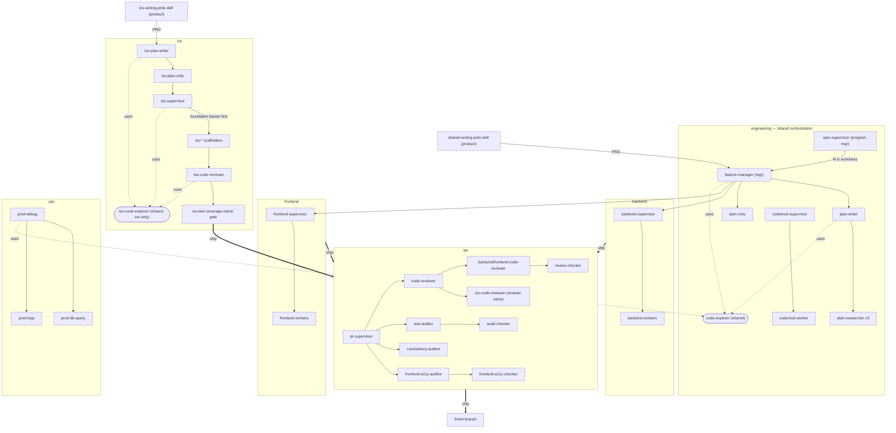

# Agent Dispatch Guide

Quick reference for the orchestrator. Before dispatching parallel agents, read this to know which model to assign and which agents can be batched.

**Layout — the factory floor.** Agents are grouped into *departments*: `product/` is the PRD skill (not an agent); **`engineering/`** holds the `feature-manager`, the plan/spec cell, shared tools (`code-explorer`, codemod, `pre-commit`), and `backend/`+`frontend/`+`ios/` build cells; **`qa/`** holds every review + audit agent; **`ops/`** holds prod debugging. Discovery is recursive and **dispatch is by `name`**, so folders are organizational only. See the floor plan below.

The floor plan below is organized by department — **backend**, **frontend**, **ios** — plus the shared engineering orchestration (`feature-manager`/`plan-writer`/`plan-critic`), `qa`, and `ops`. All three departments now share one shape: an architect/critic gate on the plan, then a department supervisor (`backend-supervisor`/`frontend-supervisor`/`ios-supervisor`, all `Agent`-tool-bearing) dispatches workers, runs its own build + test gate, and commits — `ios-supervisor` is the direct iOS-track counterpart to the other two, dispatched directly on the plan since there is no `feature-manager` integration for iOS yet (see "Known limitations for this repo's shape" below). The one structural difference left: iOS has an extra hard gate backend/frontend don't — the **foundation barrier** (new design-system surface must be reviewed and snapshot-locked before any dependent screen is built). All three route through `pr-supervisor` → `code-reviewer` for an optional pre-PR sweep. See [iOS Roster (native track)](#ios-roster-native-track) below for the full agent table.

## Factory floor plan

## Model Tiers & Batching

Three tiers: **haiku** for mechanical, gate-checked work (`backend-migration-gen`, `backend-store-crud`, `backend-api-endpoint`, `backend-error-handler`, `codemod-worker`, `prod-db-query`, `prod-logs`, `pre-commit`, and the iOS scaffolders in the "Mechanical scaffolders" table below); **sonnet** for everything needing comprehension or judgment; **opus** for `security-auditor`, `plan-writer` (on large features), and `ios-plan-writer`. Model tier doesn't decide batching — **task isolation does**.

**History + why haiku is safe now:** these workers ran on haiku once before and were demoted after quality failures (missed logic, introduced bugs) — an *ambiguity* failure, not a capability one. The re-promotion rests on four mechanisms the harness now has: per-function behavior contracts in plans, failing tests written BEFORE implementation (the executable contract), canonical-file excerpts pasted into every haiku dispatch, and a supervisor escalation ladder (one retry → sonnet re-dispatch). Supervisors track escalation rates per worker type — that number, not vibes, decides promotions/demotions.

### Effort tiers

A second, independent knob alongside model tier: `effort: low|medium|high|xhigh|max` in an agent's
own frontmatter pins that subagent's reasoning effort regardless of the session default (see
[the sub-agents frontmatter reference](https://code.claude.com/docs/en/sub-agents.md#supported-frontmatter-fields)).
This repo dispatches subagents with the plain `Agent` tool, which has no per-call effort override —
same reason `model:` is a static frontmatter field here rather than a `Workflow`-tool argument, so
`effort:` follows the same shape: set once on the agent definition, not passed at dispatch time.

Three tiers, mirroring the model-tier framing — mechanical work needs less deliberation, judgment
work benefits from more:

| Tier | Agents | Why |
|------|--------|-----|
| `effort: low` | `backend-migration-gen`, `backend-store-crud`, `backend-api-endpoint`, `backend-error-handler`, `codemod-worker`, `prod-db-query`, `prod-logs`, `pre-commit`, and the iOS haiku scaffolders (`ios-model-scaffold`, `ios-networking-endpoint`, `ios-design-system`, `ios-screen-builder`, `ios-test-writer`, `ios-snapshot-test-writer`, `ios-uitest-writer`) | Same haiku-tier workers above — mechanical, gate-checked by tests/build/lint (or the coordinator's build/gate) afterward. Deliberation is a cost with no payoff on a narrow, checked task |
| *(no field)* | Everything else — supervisors, builders, code-editors, orchestrators, `ios-code-reviewer` | Inherits the session's default effort. Not every sonnet-tier agent has been swept yet; this is a first slice, not a full-roster pass |
| `effort: high` | `plan-critic`, `backend-debug-helper`, `security-auditor`, `frontend-theme-designer`, `plan-writer`, and their iOS counterparts `ios-plan-critic`, `ios-plan-writer`, `ios-mockups-screen-builder` | Judgment/adversarial-review work — the entire job is to find what a first pass missed (a plan gap, a root cause, a vulnerability, a contrast/generic-ness or slop-tell failure, a large multi-domain contract) |

Same caveat as `model:`/`tools:`/`skills:`: roster frontmatter is read at session start, so an
`effort:` addition or change is live only for sessions started after it lands.

### Batchable workers — fire in parallel freely
These agents read a doc then execute a scoped task, each touching isolated files. Safe to fire in parallel, however many.

| Agent | Reads | Task |
|-------|-------|------|
| `backend-api-endpoint` | `docs/HANDLERS.md`, `docs/ERROR-HANDLING.md` | Add endpoint to existing feature |
| `backend-error-handler` | `docs/ERROR-HANDLING.md` | Add error type + handleError mapping |
| `backend-feature-scaffold` | `docs/ARCHITECTURE.md`, `docs/HANDLERS.md`, `docs/ERROR-HANDLING.md`, `docs/STORE.md` | Scaffold complete handler/processor/store for new feature |
| `backend-store-crud` | `docs/STORE.md` | Add CRUD methods to store layer |
| `backend-migration-gen` | `docs/STORE.md` | Generate Flyway SQL migration |
| `backend-unit-test-writer` | `docs/TESTING.md` | Write processor + handler unit tests (gomock) |
| `backend-store-test-writer` | `docs/TESTING.md` | Write store-layer tests against real Postgres |
| `backend-integration-test-writer` | `docs/TESTING.md` | Write real-HTTP integration tests |
| `backend-kafka-integration` | `docs/KAFKA_SETUP.md`, `docs/ARCHITECTURE.md` | Add Kafka producer + consumer/worker |
| `backend-test-scaffold` | `docs/TESTING.md` | Determine and generate tests at all levels |
| `frontend-style-checker` | quiet token docs (`quiet:DESIGN.md`, `dist/quiet.css`) + `webapp/docs/` supplement | Validate SCSS against quiet's `--q-*` tokens |
| `frontend-test-fixer` | `webapp/docs/REACT19-PATTERNS.md`, `webapp/docs/TESTING-PATTERNS.md` | Fix failing frontend tests |
| `frontend-theme-designer` | `quiet:DESIGN.md#product-themes`, the template's [migration plan](https://github.com/OptimusFoundry/saas-template/blob/main/docs/design-system-migration.md) §3.2 | Create or refine a quiet product theme — a `[data-theme]` light and dark pair in `@layer q.themes`, registered with `defineThemes` — contrast computed (APCA + WCAG AA), checked against an anti-generic checklist. growth-tools ships quiet's built-in `foundry` / `foundry-dark` (no product theme) as of 2026-10-08. One instance per theme pair, safe to batch. For a sweep across many themes, stage the dispatch deliberately instead of one flat parallel batch (no cross-exposure between sibling revisions, independent critique lenses) — see the agent's own "Scaling to many themes" |
| `prod-db-query` | — | Run read-only SQL against prod RDS via SSM port-forward (dispatched by prod-debug) |
| `prod-logs` | — | Filter CloudWatch log events from `api-logs` (dispatched by prod-debug) |
| `pre-commit` | — | Run CI checks, auto-fix build/lint issues |
| `plan-researcher` | layer docs (`STORE.md`/`HANDLERS.md`/`COMPONENT-PATTERNS.md`…) | Resolve one layer's contract (db/api/fe) for a plan — dispatched by `plan-writer`, three in parallel |
| `review-checker` | the checklist passed in its task | Review one file against a checklist — dispatched by a code reviewer, one per changed file |
| `audit-checker` | the criteria passed in its task | Evaluate one scope (file/rule/dimension) against criteria — dispatched by the auditors/critics |
| `frontend-a11y-checker` | `webapp/docs/A11Y-PATTERNS.md` | Static a11y audit of one page — dispatched by `frontend-a11y-auditor` |
| `codemod-worker` | the transform rule in its task | Apply one mechanical transform to an assigned file set — dispatched by `codemod-supervisor` |
| `code-explorer` | a question / scope | Read-only exploration → structured findings (symbols, call chains, wiring, blast radius); shared — dispatched by feature-manager/plan-writer/prod-debug/codemod-supervisor |

### Orchestrators & judgment — run individually
These agents coordinate other agents or need broad codebase understanding, so parallel runs waste context and may conflict. Run one at a time.

| Agent | Task |
|-------|------|
| `feature-manager` | Engineering manager: PRD → tech spec (`plan-writer` + `plan-critic`) → build (`backend-supervisor` then `frontend-supervisor`). Owns one feature end-to-end |
| `backend-supervisor` | Execute a backend plan end-to-end, tests-first: scaffold stubs → failing tests from contracts → implement to green (haiku tier + escalation) → gates → pre-commit → commit |
| `frontend-supervisor` | Execute a frontend plan end-to-end, tests-first: MSW handlers + specs from contracts → implement against them → build + lint + lint:scss once → commit (Playwright is the user's manual step); for a UI change the measured check is the `quiet-app` skill's "Before you finish": `npx quiet-audit <url> --width 1280,390 --theme foundry,foundry-dark` per migrated route |
| `plan-writer` | Orchestrate a **code-free** tech plan from a PRD path: decide the shared contract, fan out `plan-researcher` ×3, synthesize + flip the epic to Planned (opus for large features) |
| `code-reviewer` | Full-stack code review across Go backend and React frontend |
| `backend-code-reviewer` | Go backend pattern validation |
| `frontend-code-reviewer` | React 19 / TypeScript review of components on quiet (rule skills + `quiet:docs/guidelines/checklist.md`; the `quiet-app` skill for layout findings) |
| `backend-debug-helper` | Trace execution paths, identify root causes |
| `prod-debug` | Investigate production errors and anomalous DB values (SSM + CloudWatch) |
| `backend-go-specialist` | Idiomatic Go guidance, architectural patterns |
| `pr-prep` | Full pre-PR checklist across backend + frontend |
| `frontend-page-builder` | Scaffold new routes, pages, tabs, and forms on quiet (preloads the `quiet-app` skill + quiet guidelines) |
| `frontend-component-builder` | Build React 19 components on quiet (preloads the `quiet-app` skill + quiet guidelines) |
| `frontend-e2e-test-writer` | Write exhaustive Playwright E2E tests |
| `plan-critic` | Adversarially review a tech plan before build → GO/NEEDS-WORK (2 grouped checkers; 1 revision round max — residual findings ride as known-risks) |
| `test-auditor` | Audit test quality + coverage (`audit-checker`s over batches of ~3 test files) |
| `consistency-auditor` | Sweep house-rule violations repo-wide (one `audit-checker` per rule-GROUP, 3 total) |
| `frontend-a11y-auditor` | Accessibility audit across pages (per-page `frontend-a11y-checker`s + optional browser) |
| `codemod-supervisor` | Repo-wide mechanical change: discover → transform (script or `codemod-worker`s) → verify |
| `pr-supervisor` | Pre-PR gate: fan out `code-reviewer` + auditors → GO/NO-GO |
| `epic-supervisor` | Pattern B program manager: run N `feature-manager`s in parallel worktrees (one per feature) |

### opus — use sparingly
Deep expertise tasks. Run one at a time.

| Agent | Task |
|-------|------|
| `security-auditor` | OWASP security audit |

---

## iOS Roster (native track)

The iOS agents (`.claude/agents/engineering/ios/`) support the **native-iOS track** (`ios/`, `mockups/`).
`ios-supervisor` carries the `Agent` tool and dispatches the scaffolders itself — the same shape as
`backend-supervisor`/`frontend-supervisor`, just not (yet) called by `feature-manager` (see "Known
limitations for this repo's shape" below). See the root `CLAUDE.md` "Native app workflow" section for
the full pipeline (worktree → **Capture** `ios-writing-prds` → **Architect** `ios-plan-writer` →
**Critic** `ios-plan-critic` → **Execute** `ios-supervisor`: Phase 0 foundation barrier → stubs → red
tests → green → screens → UI tests → gate → finish-branch).

The grouping below is preserved as-is from the source template rather than folded into the "Batchable workers" / "Orchestrators & judgment" split above — it carries real meaning about model tier and parallelization that doesn't map cleanly onto the backend/frontend taxonomy (iOS batches by *phase* and *file disjointness*, not by a haiku-promotion history).

### Judgment / orchestration (run individually)

| Agent | Model | Task |
|-------|-------|------|
| `ios-plan-writer` | opus | Architect a **contract-level** plan from the docs — interfaces, signatures, tokens/components by name, the named mockup, a11y ids, acceptance criteria, a ticket table under the feature's TRACKER epic, the phase ordering. Not code bodies. Dispatches `ios-code-explorer` to resolve existing wiring/call chains before committing to a contract. |
| `ios-plan-critic` | sonnet | Adversarially review an `ios-plan-writer` plan before dispatch → GO/NEEDS-WORK (coverage & contract + edges & placement checklists; up to 2 revision rounds, matching the backend `plan-critic` — residual advisory findings ride as known-risks). M/L plans only; XS/S fast-mode plans skip it. Dispatches `ios-code-explorer` to verify a plan's claims against the actual code rather than trusting the plan's prose. |
| `ios-supervisor` | sonnet | Executes the plan end-to-end — dispatches the scaffolders below in phase order (Phase 0 foundation barrier → stubs → red tests → green → screens → UI tests), runs the build + `ios-test-coverage-check` gate, commits. The iOS-track counterpart to `backend-supervisor`/`frontend-supervisor`. |
| `ios-code-explorer` | sonnet | Read-only Swift exploration → structured findings (symbols, call chains, chrome/component wiring, blast radius) via SwiftLSP. The `ios/` counterpart to the shared `code-explorer` — use this instead of the generic `Explore` agent or `code-explorer` for any `ios/AITravel/` investigation; it carries the sourcekit-lsp warm-index caveat the shared one doesn't need. Dispatched by `ios-plan-writer`/`ios-plan-critic`/`ios-code-reviewer`/`ios-supervisor`, or directly for ad-hoc research. |

Feature capture ahead of `ios-plan-writer` is the `ios-writing-prds` **skill**, not an agent (the iOS-track counterpart to `shared-writing-prds`) — it writes the PRD and the epic row in `docs/TRACKER.md`, shared with the backend epic board.

### Mechanical scaffolders (haiku) — batch freely on DISJOINT files

The gates catch what slips, so the whole scaffolder tier — including the two that make visual calls —
runs on haiku; the design judgment lives in the plan + `v2/mockups/`, not in the model.

| Agent | Model | Reads | Produces |
|-------|-------|-------|----------|
| `ios-model-scaffold` | haiku | `ios/docs/engineering/02-models.md` | a model (reference or leaf value) + its `*DTO` + `toDomain()/toDTO()` + `SampleData+<Domain>` seed |
| `ios-networking-endpoint` | haiku | `ios/docs/engineering/04-networking.md` | one `Requests/<Verb><Name>Request.swift` (`mockResponse(from: seed)`) — no edits to the generic shells |
| `ios-design-system` | haiku | `ios/docs/engineering/05-design-system.md` + root `CLAUDE.md` | a **semantic** token / modifier / component (incl. chrome pieces like `TopBar`/`FloatingTabBar`/`CTABar`), ported from `v2/mockups/` + `foundations.css` |
| `ios-screen-builder` | haiku | `ios/docs/engineering/06-screens.md` + root `CLAUDE.md` | a screen: `…View` (real `TopBar`/tab-bar/`CTABar` components + private `@ViewBuilder` sections — no shared scaffold wrapper) + `…Presenter` + `Route` + catalog + seeded `#Preview` + a11y ids; **names its mockup** |
| `ios-test-writer` | haiku | `ios/docs/engineering/07-testing.md` §3–5 | functional tests (model methods, commands incl. rollback, DTO round-trip, presenter, codec) |
| `ios-snapshot-test-writer` | haiku | `ios/docs/engineering/07-testing.md` §6 | render-snapshot tests (the lock) |
| `ios-uitest-writer` | haiku | `ios/docs/engineering/07-testing.md` §7 | XCUITest flows vs `MockScenario` (launch-env injection, a11y audit) |

### Reviewer / gate (validates, doesn't fix)

| Agent | Model | Validates |
|-------|-------|-----------|
| `ios-code-reviewer` | sonnet | the **only** iOS review gate — a change vs the **engineering** docs (MainActor-default concurrency, `AppStore.shared` as the sole instance via `private init`, semantic-tokens-only, provider-swappability, logic-out-of-views, four-layer coverage) **and**, for a screen, port fidelity to its named mockup + the visual non-negotiables. No separate design or fidelity reviewer. Dispatches `ios-code-explorer` for reference-integrity sweeps (§9) when a symbol's shape changed. |

### Non-iOS

| Agent | Model | Task |
|-------|-------|------|
| `ios-mockups-screen-builder` | sonnet | AUTHOR/AUDIT the HTML/CSS `mockups/` (the visual SSOT; `foundations.css` is the token source the Swift primitives are hand-authored 1:1 from and parity-tested against). Edited directly, not through the Swift pipeline. |

**The iOS gates → who owns each**

| Gate | Owner | When |
|------|-------|------|
| **Foundation barrier** | `ios-code-reviewer` reviews the new design-system surface + its render snapshots are green | end of Phase 0, only when the wave touched `DesignSystem/`, before any dependent screen |
| **Composition primitives** | `ios-screen-builder` composes them; `ios-code-reviewer` checks no hand-rolled chrome/layout | every screen |
| **Port fidelity** | `ios-code-reviewer` (screen vs its named mockup) → then `ios-snapshot-test-writer` locks it | every screen |
| **Coverage** | `ios-code-reviewer` + the `ios-test-coverage-check` skill | the commit gate ("green build ≠ done") |

**Parallelization & shared-file serialization:**
- Batch the haiku scaffolders on DISJOINT files — models, endpoints, tokens/components, and screen files are new files, so they don't collide on `.pbxproj`.
- Serialize edits to shared files: a new stored `AppStore` property (`AppStore.swift`), a brand-new catalog section (`ScreenCatalogView.swift`), and any `.pbxproj` change (new SPM dep / target / bundled resource). The plan (from `ios-plan-writer`) flags these; dispatch them one at a time.

**Exploring Swift before acting:** dispatch `ios-code-explorer` (not the generic `Explore` agent or the
shared `code-explorer`) for any read-only "find/trace/map ios/AITravel/" question — it knows the
sourcekit-lsp warm-index caveat below and falls back to grep honestly instead of asserting a negative
from a cold index.

**Navigating Swift — SwiftLSP first:** use the `LSP` tool for Swift symbols (`documentSymbol` to enter a file, then `goToDefinition` / `findReferences` / `hover`), not `Grep`/`Read`. The `ios-worktree` command warms a per-worktree sourcekit-lsp index. If `findReferences` / cross-file `goToDefinition` come back empty but `hover` works, that's a stale index — rebuild (`xcodebuild … build`) rather than working around it with grep.

---

## Available Tools & Plugins

Use these throughout — don't rely solely on Read/Grep/Bash.

| Tool | When to use |
|------|-------------|
| **Superpowers skills** (`Skill` tool) | Check for an applicable skill before starting any task — there usually is one. Key skills: `subagent-driven-development`, `writing-plans`, `using-git-worktrees`, `finishing-a-development-branch` |
| **LSP** (`LSP` tool) | Go, TypeScript, and Swift code navigation — go-to-definition, find-references, hover types. Prefer over grep when tracing types or call chains. **Foreground-only for subagents:** a subagent dispatched with `run_in_background: true` (the `Agent` tool's default) loses `LSP` access entirely in this Claude Code version, even when `LSP` is in its granted `tools:` list — a backgrounded child that needs LSP silently falls back to grep/read instead of erroring. Any dispatcher of an LSP-holding agent (see the roster tables above for which ones hold it) must pass `run_in_background: false`; see "Parallelisation Rules" below for how this composes with batching |
| **Browser automation** (`mcp__claude-in-chrome__*`) | Verify frontend changes in a real browser. Use after `frontend-supervisor` completes to confirm UI behaviour |
| **Playwright MCP** (`mcp__plugin_playwright_*`) | Programmatic browser control for E2E verification |
| **ToolSearch** | Discover available tools before doing something manually — run `ToolSearch` first if unsure what's available |

---

## Parallelisation Rules

1. **Batchable workers are safe to batch** — they read docs then write isolated files, so they don't conflict. Fire as many as needed in one `Agent` tool call batch. Batching is gated by file isolation, not model tier.
2. **Orchestrators & judgment agents run individually** — they explore the codebase broadly; parallel runs waste context and may conflict.
3. **opus (`security-auditor`) runs alone** — expensive; only one at a time.
4. **Mixed work**: dispatch all batchable workers first in one batch, then run orchestrator/judgment agents sequentially.
5. **Foreground dispatch is mandatory for any agent that holds the `LSP` tool — this is not optional, and it does not conflict with batching.** A backgrounded subagent (`run_in_background: true`, the `Agent` tool's default) loses `LSP` access entirely in this Claude Code version, even when `LSP` is in its granted `tools:` list. "Batch" and "foreground" are independent axes: sending several `Agent` calls in one message is what makes them run in parallel; `run_in_background: false` on each of those calls is what makes the parent turn block and collect every result before continuing, instead of scattering unresolved children it can't track. Every supervisor/critic/reviewer that dispatches an LSP-holding agent (`code-explorer`, `ios-code-explorer`, `audit-checker`, `review-checker`, `plan-researcher`, `codemod-worker`, any `backend-*`/`frontend-*`/`ios-*` build-cell worker, the `*-code-reviewer`s, `frontend-a11y-checker`) carries a "Dispatch discipline" section spelling this out — treat a dispatcher of an LSP agent that lacks one as a bug to fix, not a style gap.

## Known limitations for this repo's shape

- **(Resolved 2026-07-26) `webapp/` landed via PR #9** ("pull webapp/ frontend track from
  saas-template") — `feature-manager`/`epic-supervisor` dispatching `frontend-supervisor` is now fully
  usable for full-stack (backend+frontend) features. See root `CLAUDE.md`'s "Frontend Workflow". Use
  `plan-writer` → `plan-critic` → `backend-supervisor` directly only for backend-only work (root
  `CLAUDE.md`'s "Backend Workflow"), and the same pattern with `frontend-supervisor` for frontend-only
  work.
- **`ios-supervisor` has no `feature-manager` integration.** Unlike `backend-supervisor`/
  `frontend-supervisor`, nothing dispatches `ios-supervisor` as part of a full-stack feature —
  `ios-plan-writer` and `ios-plan-critic` gate the plan, then `ios-supervisor` is dispatched directly.
  A feature spanning both backend and iOS registers as **two separate epics** (see `ios-writing-prds`),
  not one `feature-manager`-orchestrated feature.
- **`ios-supervisor` runs `.claude/scripts/ios-gate-check.sh` as a hard gate, not an optional check.**
  `verify-writes` catches a scaffolder that silently wrote to the main checkout instead of its worktree;
  `parse-test-log` catches the `XCTSkip` trailing-banner false-failure. Both were added 2026-07-26 after
  a transcript audit found the two patterns recurring across sessions — see
  `docs/superpowers/plans/2026-07-26-ios-pipeline-reliability.md`.

## Docs Reference

Backend worker agents read from `base-server/docs/`:

| Doc | Contents |
|-----|----------|
| `ARCHITECTURE.md` | Directory structure, naming, imports, DI, context |
| `ERROR-HANDLING.md` | Two-tier pattern, apierrors functions, handleError |
| `STORE.md` | sqlx patterns, nil-slice rule, soft deletes, migrations |
| `TESTING.md` | Three test levels, table-driven rules, running tests |
| `CONFIGURATION.md` | Env vars, build commands, Docker, security |
| `HANDLERS.md` | Request/response structs, handler/processor templates, routing |
| `KAFKA_SETUP.md` | Producer, consumer/worker, bootstrap integration |

Frontend agents read quiet's docs in `webapp/vendor/quiet/` (DESIGN.md, docs/guidelines/), the repo copy of quiet's `quiet-app` skill (`.claude/skills/quiet-app/`) and the template supplement in `webapp/docs/`. quiet's docs are cited as `quiet:<package-root path>#<anchor>` (e.g. `quiet:docs/guidelines/spacing.md#job-tokens`) and exist only after `npm install` in `webapp/`.

**`webapp/docs/`:**

| Doc | Contents |
|-----|----------|
| `ARCHITECTURE.md` | Feature module structure, routes, hooks, API layer, contexts |
| `COMPONENT-PATTERNS.md` | React 19 patterns, SCSS template, Storybook template |
| `REACT19-PATTERNS.md` | New APIs, deprecated patterns, testing patterns |
| `PATTERNS.md` | Page composition: shell, heading, section, empty state rhythm |
| `PAGE-TEMPLATES.md` | Copy-paste scaffolds for 4 page shapes |
| `TEMPLATE-PATTERNS.md` | Template-only patterns quiet doesn't cover: app shell, AsyncList, gating, useNotify, AppIcon, RouterLink |
| `TESTING-PATTERNS.md` | Vitest, RTL, Playwright, MSW patterns |

iOS agents (see [iOS Roster](#ios-roster-native-track) above) read from `ios/docs/engineering/` (how
it's **built**) and, for "how it **looks**", root `CLAUDE.md`'s "five non-negotiable rules" plus the
named fidelity target in `v2/mockups/`. There is no separate numbered design-docs corpus for iOS — the
old J-rule-numbered one (Tokyo/v1) was retired once the Swift app finished migrating to v2 content; see
root `CLAUDE.md`'s "Design-system layout".

| Doc | Contents |
|-----|----------|
| `ios/docs/engineering/00-overview.md` → `09-ui-e2e-testing.md` | Architecture, models, store, networking, design-system port, screens, the four-layer testing pyramid |
| The `ios-*-rules` skills (`ios-architecture-rules`, `ios-models-networking-rules`, `ios-design-system-rules`, `ios-screens-rules`, `ios-testing-rules`) | Compact, rule-ID-backed checklists over the same doc tree — see the "iOS Roster" table above |

Violations require a written entry in `docs/decisions.md` (append-only — new entries supersede, never edit).
